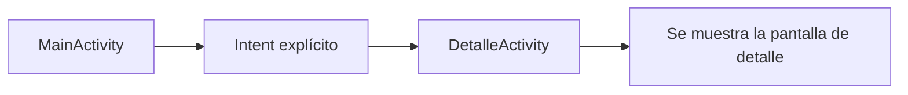
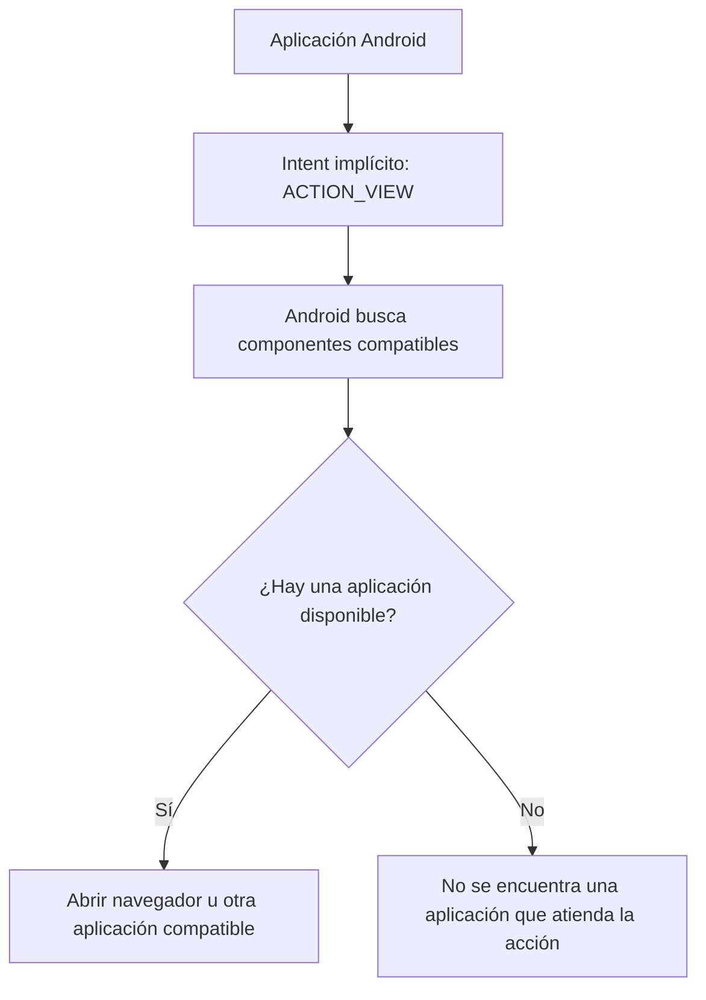

# Intents explícitos e implícitos en Android con Java

## Introducción

En Android, un **`Intent`** es un objeto que permite solicitar una acción a otro componente de la aplicación o del sistema operativo. Se utiliza, por ejemplo, para abrir otra `Activity`, iniciar un servicio o compartir información con otra aplicación.

En Android se distinguen principalmente dos formas de iniciar una acción:

- **Intent explícito:** indica directamente qué componente (por ejemplo, una `Activity` o un `Service`) debe recibir la solicitud.
- **Intent implícito:** describe una acción que se desea realizar, sin indicar una clase concreta. Android busca qué componente o aplicación puede atenderla.

> Importante: en Android, los términos *explícito* e *implícito* describen cómo se determina el componente destinatario. No se refieren a si la intención del usuario está expresada directa o indirectamente en lenguaje natural.

## 1. Intent explícito

Un `Intent` explícito identifica el componente de destino mediante su clase. Se utiliza habitualmente para navegar entre pantallas de una misma aplicación.

### Ejemplo: abrir una segunda Activity

Supongamos que tenemos dos actividades:

- `MainActivity`: pantalla principal.
- `DetalleActivity`: pantalla que muestra información adicional.

**Código Java en `MainActivity.java`:**

```java
Intent intent = new Intent(MainActivity.this, DetalleActivity.class);
startActivity(intent);
```

En este ejemplo:

- `Intent` crea el objeto que representa la solicitud.
- `MainActivity.this` es el contexto desde el que se inicia la acción.
- `DetalleActivity.class` identifica exactamente el componente de destino.
- `startActivity(intent)` solicita a Android que abra la actividad indicada.

### Ilustración del flujo explícito



### Enviar datos con un Intent explícito

También es posible enviar información entre actividades utilizando extras.

**MainActivity.java:**

```java
Intent intent = new Intent(MainActivity.this, DetalleActivity.class);
intent.putExtra("nombre", "Camila");
startActivity(intent);
```

**DetalleActivity.java:**

```java
String nombre = getIntent().getStringExtra("nombre");
TextView txtNombre = findViewById(R.id.txtNombre);
txtNombre.setText(nombre);
```

La actividad de destino recupera el dato mediante `getIntent()` y `getStringExtra()`.

## 2. Intent implícito

Un `Intent` implícito no especifica una clase de destino. En su lugar, define una acción, y opcionalmente datos o categorías. Android determina qué componente puede responder a esa solicitud.

Se utiliza, por ejemplo, para:

- Abrir una página web.
- Compartir texto.
- Enviar un correo mediante una aplicación compatible.
- Abrir un mapa o visualizar una ubicación.

### Ejemplo: abrir una página web

```java
Intent intent = new Intent(
    Intent.ACTION_VIEW,
    Uri.parse("https://www.google.com")
);

startActivity(intent);
```

En este caso:

- `Intent.ACTION_VIEW` indica que se desea visualizar un recurso.
- `Uri.parse(...)` representa la dirección web.
- No se especifica qué aplicación debe abrir la dirección.
- Android busca una aplicación compatible, como un navegador.

### Ilustración del flujo implícito



### Ejemplo: compartir texto

```java
Intent intent = new Intent(Intent.ACTION_SEND);
intent.setType("text/plain");
intent.putExtra(Intent.EXTRA_TEXT, "Estoy aprendiendo Android con Java");

startActivity(Intent.createChooser(intent, "Compartir mediante"));
```

Este código solicita compartir texto. `Intent.createChooser()` permite mostrar al usuario un selector de aplicaciones compatibles.

## 3. Diferencias entre Intent explícito e implícito

| Característica | Intent explícito | Intent implícito |
|---|---|---|
| Destino | Se indica una clase o componente concreto | No se indica una clase concreta |
| Uso frecuente | Navegación entre actividades de una app | Acciones que pueden atender otras aplicaciones |
| Resolución | El destino está definido en el código | Android busca componentes compatibles |
| Ejemplo | Abrir `DetalleActivity` | Abrir una URL con `ACTION_VIEW` |
| Flexibilidad | Dirige la solicitud a un componente específico | Permite que distintas aplicaciones atiendan la acción |

## 4. Ejemplo práctico: aplicación de estudiantes

Imaginemos una aplicación que permite consultar información académica.

**Acción 1: abrir la pantalla de notas**

Se utiliza un Intent explícito porque conocemos la actividad que debe abrirse.

```java
Intent intent = new Intent(MainActivity.this, NotasActivity.class);
startActivity(intent);
```

**Acción 2: abrir el sitio web institucional**

Se utiliza un Intent implícito porque queremos que Android encuentre una aplicación capaz de visualizar la dirección.

```java
Intent intent = new Intent(
    Intent.ACTION_VIEW,
    Uri.parse("https://www.santotomas.cl")
);

startActivity(intent);
```

## 5. Declarar un filtro de Intent

Los filtros de intent permiten que un componente declare qué intents implícitos puede atender. Se configuran normalmente en el archivo `AndroidManifest.xml`.

Ejemplo simplificado para una actividad que puede responder a una acción de visualización de enlaces web:

```xml
<activity
    android:name=".WebActivity"
    android:exported="true">

    <intent-filter>
        <action android:name="android.intent.action.VIEW" />
        <category android:name="android.intent.category.DEFAULT" />
        <category android:name="android.intent.category.BROWSABLE" />
        <data android:scheme="https" />
    </intent-filter>

</activity>
```

Este filtro declara compatibilidad con determinados enlaces HTTPS. En una aplicación real, conviene restringir los datos admitidos mediante atributos como `android:host` y, si corresponde, `android:pathPrefix`.

`android:exported` indica si otros componentes de aplicaciones pueden iniciar esta actividad. En componentes con filtros de intent, debe declararse explícitamente en versiones modernas de Android.

## 6. Buenas prácticas

- Utilizar intents explícitos para navegar entre componentes propios cuando el destino es conocido.
- Utilizar intents implícitos cuando se desea delegar una acción a una aplicación compatible.
- Validar los datos recibidos mediante extras antes de utilizarlos.
- Considerar que un Intent implícito puede no encontrar una aplicación compatible.
- Cuando sea necesario, comprobar si existe una aplicación que pueda atender la solicitud o manejar la excepción correspondiente.
- Evitar exponer componentes innecesariamente mediante `android:exported`.

Por ejemplo, para evitar que la aplicación falle si no existe una aplicación que pueda abrir una URL:

```java
Intent intent = new Intent(
    Intent.ACTION_VIEW,
    Uri.parse("https://www.google.com")
);

if (intent.resolveActivity(getPackageManager()) != null) {
    startActivity(intent);
} else {
    Toast.makeText(
        this,
        "No hay una aplicación disponible",
        Toast.LENGTH_SHORT
    ).show();
}
```

## 7. Actividad práctica

Crea un proyecto Android en Java con dos actividades:

1. `MainActivity`: contiene un botón llamado **Ver detalle** y otro llamado **Abrir sitio web**.
2. `DetalleActivity`: muestra un mensaje recibido desde la actividad principal.

Implementa los siguientes requisitos:

- Al presionar **Ver detalle**, utiliza un Intent explícito para abrir `DetalleActivity`.
- Envía el nombre de un estudiante mediante `putExtra()`.
- En `DetalleActivity`, recupera el nombre y muéstralo en un `TextView`.
- Al presionar **Abrir sitio web**, utiliza un Intent implícito con `ACTION_VIEW` para abrir una dirección web.
- Prueba ambos botones y explica qué componente determina el destino en cada caso.

## Conclusión

En Android con Java, los **intents explícitos** se utilizan cuando la aplicación conoce el componente exacto que debe iniciar. Los **intents implícitos** describen una acción y permiten que Android encuentre un componente compatible.

Comprender esta diferencia es fundamental para implementar navegación entre actividades, integración con otras aplicaciones y comunicación entre componentes Android.
